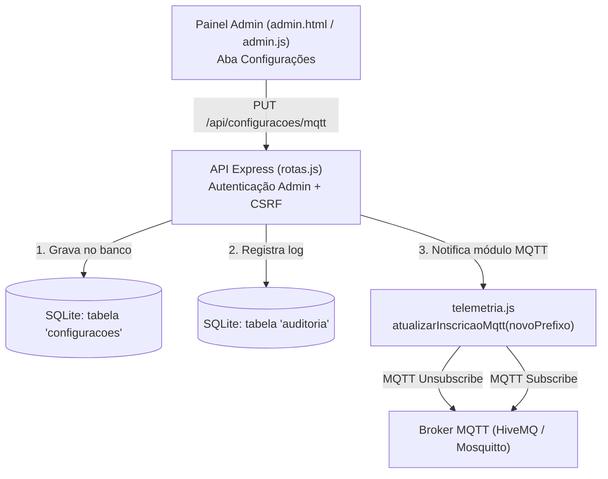

# Plano de Implementação: Configuração do Prefixo MQTT via Painel do Administrador

> **Documento de especificação técnica e guia de implementação futura.**  
> Permite que o operador/administrador configure o **Prefixo MQTT** (e opcionalmente o Broker) diretamente pela interface Web da Dashboard, sem precisar editar arquivos `.env` ou reiniciar o servidor Node.js.

---

## 1. Visão Geral e Justificativa

Atualmente, o prefixo MQTT é fixo no arquivo `.env` (`PREFIXO=meu_projeto_energia_123`) e carregado na inicialização da aplicação. 

Ao disponibilizar essa configuração na tela do Administrador:
- **Facilidade operacional**: O usuário configura novos ambientes ou integrações sem acesso ao terminal do servidor.
- **Dinamismo em tempo real**: O servidor cancela a assinatura antiga (`unsubscribe`) e assina o novo tópico (`subscribe`) imediatamente.
- **Histórico e auditoria**: Toda alteração de prefixo é registrada na tabela `auditoria` (quem alterou, quando e o endereço IP).

---

## 2. Arquitetura da Solução



---

## 3. Roteiro Passo a Passo de Implementação

### Passo 1: Banco de Dados (`dashboard_web/src/db.js`)
Criar uma tabela chave-valor persistente para armazenar configurações do sistema:

```sql
CREATE TABLE IF NOT EXISTS configuracoes (
  chave         TEXT PRIMARY KEY,
  valor         TEXT NOT NULL,
  atualizado_em TEXT NOT NULL DEFAULT (strftime('%Y-%m-%dT%H:%M:%fZ','now'))
);
```

Funções auxiliares no `db.js`:
```javascript
function obterConfiguracao(chave, valorPadrao = null) {
  const row = db.prepare('SELECT valor FROM configuracoes WHERE chave = ?').get(chave);
  return row ? row.valor : valorPadrao;
}

function salvarConfiguracao(chave, valor) {
  db.prepare(`
    INSERT INTO configuracoes (chave, valor, atualizado_em)
    VALUES (?, ?, strftime('%Y-%m-%dT%H:%M:%fZ','now'))
    ON CONFLICT(chave) DO UPDATE SET
      valor = excluded.valor,
      atualizado_em = excluded.atualizado_em
  `).run(chave, valor);
}
```

---

### Passo 2: Módulo MQTT Dinâmico (`dashboard_web/src/telemetria.js`)
Tornar o tópico raiz dinâmico, permitindo reconfiguração sem reiniciar o processo:

```javascript
let prefixoAtual = db.obterConfiguracao('mqtt_prefixo', config.PREFIXO);
let topicoAssinado = `${prefixoAtual}/telemetria/#`;

function atualizarPrefixoMqtt(novoPrefixo) {
  if (!novoPrefixo || novoPrefixo === prefixoAtual) return;

  if (client && client.connected) {
    // 1. Cancela inscrição do tópico antigo
    client.unsubscribe(topicoAssinado, (err) => {
      if (err) console.error('[MQTT] Erro ao desinscrever tópico antigo:', err);
    });

    // 2. Atualiza prefixo e assina o novo tópico
    prefixoAtual = novoPrefixo;
    topicoAssinado = `${prefixoAtual}/telemetria/#`;

    client.subscribe(topicoAssinado, (err) => {
      if (!err) {
        console.log(`[MQTT] Assinatura atualizada com sucesso para: ${topicoAssinado}`);
      }
    });
  }
}
```

---

### Passo 3: Endpoints de API (`dashboard_web/src/rotas.js`)
Criar rotas protegidas apenas para administradores:

1. **`GET /api/configuracoes/mqtt`**:
   - Retorna o prefixo atual e o broker em uso.
2. **`PUT /api/configuracoes/mqtt`**:
   - **Validação**: Impedir caracteres especiais inválidos em tópicos MQTT (como `+`, `#`, espaços ou vazios).
   - Salvar no banco com `salvarConfiguracao('mqtt_prefixo', novoPrefixo)`.
   - Acionar `telemetria.atualizarPrefixoMqtt(novoPrefixo)`.
   - Registrar na auditoria:
     ```javascript
     auditar({
       usuario_id: req.usuario.id,
       email: req.usuario.email,
       acao: 'config_mqtt_alterada',
       detalhe: `Prefixo alterado para: ${novoPrefixo}`,
       ip: req.ip
     });
     ```

---

### Passo 4: Interface do Administrador (`admin.html` e `admin.js`)

1. **No menu de navegação (`admin.html`)**:
   Adicionar um botão de aba:
   ```html
   <button class="aba" data-aba="configuracoes" type="button">Configurações</button>
   ```

2. **Na seção da aba (`admin.html`)**:
   ```html
   <section id="aba-configuracoes" class="oculto">
     <div class="cabecalho-secao">
       <div>
         <h2>Configurações do Sistema</h2>
         <p>Ajuste os parâmetros de comunicação com os controladores e medidores.</p>
       </div>
     </div>

     <div class="painel" style="max-width: 600px;">
       <form id="form-config-mqtt">
         <div class="campo">
           <label for="cfg-prefixo">Prefixo MQTT</label>
           <input type="text" id="cfg-prefixo" name="prefixo" required 
                  pattern="[a-zA-Z0-9_\-]+"
                  placeholder="Ex: meu_projeto_energia_123">
           <small class="mudo">Deve ser exatamente igual ao `PREFIXO` gravado no código do Arduino/ESP32.</small>
         </div>

         <div class="campo">
           <label>Broker MQTT Atual</label>
           <input type="text" id="cfg-broker" readonly class="desabilitado" value="broker.hivemq.com:1883">
         </div>

         <div class="botoes-form">
           <button type="submit" class="botao botao-primario">Salvar e Reconectar</button>
         </div>
       </form>
     </div>
   </section>
   ```

3. **No script (`admin.js`)**:
   - Carregar o valor atual via `GET /api/configuracoes/mqtt` ao abrir a aba.
   - Enviar `PUT /api/configuracoes/mqtt` com tratamento de erro e mensagem de sucesso em caso de confirmação.

---

## 4. Testes e Validação Recomendados

Quando formos implementar:
1. **Teste de Validação de Input**: Tentar salvar prefixos vazios ou com caracteres coringa (`#`, `+`) e verificar se a API rejeita com `HTTP 400`.
2. **Teste de Permissão**: Tentar acessar a rota como cliente comum e verificar retorno `HTTP 403`.
3. **Teste em Tempo Real**:
   - Alterar o prefixo para `teste_novo_123`.
   - Publicar uma leitura com o simulador ou ESP32 nesse novo prefixo.
   - Confirmar que as leituras chegam na dashboard sem reiniciar o Node.js.
4. **Persistência pós-reinicialização**:
   - Parar o servidor e subir novamente.
   - Confirmar que ele inicia lendo o prefixo salvo no SQLite.
