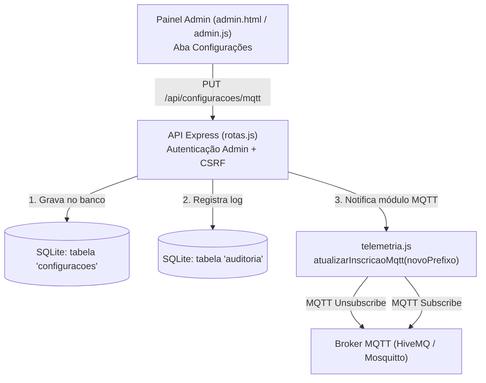
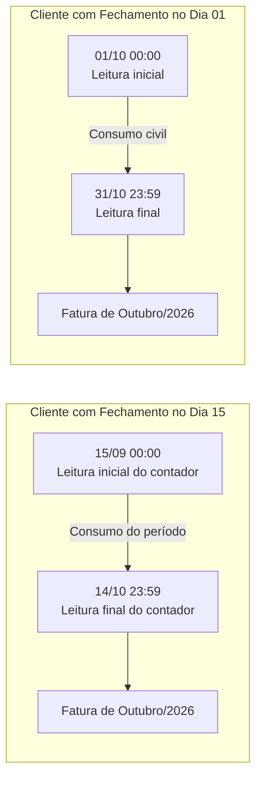

# Plano de Implementação: Configuração MQTT no Painel & Ciclos de Cobrança por Cliente

> **Documento de especificação técnica e guia de implementação futura.**  
> Contém duas melhorias arquiteturais planejadas para o sistema:
> 1. **Parte 1:** Configuração dinâmica de Prefixo e Broker MQTT diretamente pelo Painel Admin (sem mexer em `.env`).
> 2. **Parte 2:** Fechamento de faturamento e ciclos de corte personalizados por cliente (`dia_fechamento`).

---

# Parte 1: Configuração do Prefixo MQTT via Painel do Administrador

## 1. Visão Geral e Justificativa

Atualmente, o prefixo MQTT é fixo no arquivo `.env` (`PREFIXO=meu_projeto_energia_123`) e carregado na inicialização da aplicação. 

Ao disponibilizar essa configuração na tela do Administrador:
- **Facilidade operacional**: O usuário configura novos ambientes ou integrações sem acesso ao terminal do servidor.
- **Dinamismo em tempo real**: O servidor cancela a assinatura antiga (`unsubscribe`) e assina o novo tópico (`subscribe`) imediatamente.
- **Histórico e auditoria**: Toda alteração de prefixo é registrada na tabela `auditoria` (quem alterou, quando e o endereço IP).

---

## 2. Arquitetura da Solução



---

## 3. Roteiro Passo a Passo de Implementação

### Passo 1: Banco de Dados (`dashboard_web/src/db.js`)
Criar uma tabela chave-valor persistente para armazenar configurações do sistema:

```sql
CREATE TABLE IF NOT EXISTS configuracoes (
  chave         TEXT PRIMARY KEY,
  valor         TEXT NOT NULL,
  atualizado_em TEXT NOT NULL DEFAULT (strftime('%Y-%m-%dT%H:%M:%fZ','now'))
);
```

Funções auxiliares no `db.js`:
```javascript
function obterConfiguracao(chave, valorPadrao = null) {
  const row = db.prepare('SELECT valor FROM configuracoes WHERE chave = ?').get(chave);
  return row ? row.valor : valorPadrao;
}

function salvarConfiguracao(chave, valor) {
  db.prepare(`
    INSERT INTO configuracoes (chave, valor, atualizado_em)
    VALUES (?, ?, strftime('%Y-%m-%dT%H:%M:%fZ','now'))
    ON CONFLICT(chave) DO UPDATE SET
      valor = excluded.valor,
      atualizado_em = excluded.atualizado_em
  `).run(chave, valor);
}
```

---

### Passo 2: Módulo MQTT Dinâmico (`dashboard_web/src/telemetria.js`)
Tornar o tópico raiz dinâmico, permitindo reconfiguração sem reiniciar o processo:

```javascript
let prefixoAtual = db.obterConfiguracao('mqtt_prefixo', config.PREFIXO);
let topicoAssinado = `${prefixoAtual}/telemetria/#`;

function atualizarPrefixoMqtt(novoPrefixo) {
  if (!novoPrefixo || novoPrefixo === prefixoAtual) return;

  if (client && client.connected) {
    // 1. Cancela inscrição do tópico antigo
    client.unsubscribe(topicoAssinado, (err) => {
      if (err) console.error('[MQTT] Erro ao desinscrever tópico antigo:', err);
    });

    // 2. Atualiza prefixo e assina o novo tópico
    prefixoAtual = novoPrefixo;
    topicoAssinado = `${prefixoAtual}/telemetria/#`;

    client.subscribe(topicoAssinado, (err) => {
      if (!err) {
        console.log(`[MQTT] Assinatura atualizada com sucesso para: ${topicoAssinado}`);
      }
    });
  }
}
```

---

### Passo 3: Endpoints de API (`dashboard_web/src/rotas.js`)
Criar rotas protegidas apenas para administradores:

1. **`GET /api/configuracoes/mqtt`**:
   - Retorna o prefixo atual e o broker em uso.
2. **`PUT /api/configuracoes/mqtt`**:
   - **Validação**: Impedir caracteres especiais inválidos em tópicos MQTT (como `+`, `#`, espaços ou vazios).
   - Salvar no banco com `salvarConfiguracao('mqtt_prefixo', novoPrefixo)`.
   - Acionar `telemetria.atualizarPrefixoMqtt(novoPrefixo)`.
   - Registrar na auditoria:
     ```javascript
     auditar({
       usuario_id: req.usuario.id,
       email: req.usuario.email,
       acao: 'config_mqtt_alterada',
       detalhe: `Prefixo alterado para: ${novoPrefixo}`,
       ip: req.ip
     });
     ```

---

### Passo 4: Interface do Administrador (`admin.html` e `admin.js`)

1. **No menu de navegação (`admin.html`)**:
   Adicionar um botão de aba:
   ```html
   <button class="aba" data-aba="configuracoes" type="button">Configurações</button>
   ```

2. **Na seção da aba (`admin.html`)**:
   ```html
   <section id="aba-configuracoes" class="oculto">
     <div class="cabecalho-secao">
       <div>
         <h2>Configurações do Sistema</h2>
         <p>Ajuste os parâmetros de comunicação com os controladores e medidores.</p>
       </div>
     </div>

     <div class="painel" style="max-width: 600px;">
       <form id="form-config-mqtt">
         <div class="campo">
           <label for="cfg-prefixo">Prefixo MQTT</label>
           <input type="text" id="cfg-prefixo" name="prefixo" required 
                  pattern="[a-zA-Z0-9_\-]+"
                  placeholder="Ex: meu_projeto_energia_123">
           <small class="mudo">Deve ser exatamente igual ao `PREFIXO` gravado no código do Arduino/ESP32.</small>
         </div>

         <div class="campo">
           <label>Broker MQTT Atual</label>
           <input type="text" id="cfg-broker" readonly class="desabilitado" value="broker.hivemq.com:1883">
         </div>

         <div class="botoes-form">
           <button type="submit" class="botao botao-primario">Salvar e Reconectar</button>
         </div>
       </form>
     </div>
   </section>
   ```

3. **No script (`admin.js`)**:
   - Carregar o valor atual via `GET /api/configuracoes/mqtt` ao abrir a aba.
   - Enviar `PUT /api/configuracoes/mqtt` com tratamento de erro e mensagem de sucesso em caso de confirmação.

---

## 4. Testes e Validação Recomendados

Quando formos implementar:
1. **Teste de Validação de Input**: Tentar salvar prefixos vazios ou com caracteres coringa (`#`, `+`) e verificar se a API rejeita com `HTTP 400`.
2. **Teste de Permissão**: Tentar acessar a rota como cliente comum e verificar retorno `HTTP 403`.
3. **Teste em Tempo Real**:
   - Alterar o prefixo para `teste_novo_123`.
   - Publicar uma leitura com o simulador ou ESP32 nesse novo prefixo.
   - Confirmar que as leituras chegam na dashboard sem reiniciar o Node.js.
4. **Persistência pós-reinicialização**:
   - Parar o servidor e subir novamente.
   - Confirmar que ele inicia lendo o prefixo salvo no SQLite.

---

# Parte 2: Fechamento de Fatura e Ciclo Personalizado por Cliente

> **Especificação técnica para cobrança por ciclo de corte individual.**  
> Permite que cada cliente cadastrado tenha um **dia específico do mês para fechamento** (ex: dia 10, dia 15, dia 20 ou dia 1º), calculando o consumo e emitindo relatórios com base no período contratual exato.

---

## 1. Regra de Negócio e Cálculo dos Ciclos

### 1.1 Definição do Dia de Fechamento (`dia_fechamento`)
- O dia de fechamento é um número inteiro entre **1 e 28** (limitado a 28 para garantir compatibilidade com todos os meses, incluindo Fevereiro).
- **Valor padrão:** `1` (mês civil tradicional, de 01 a 31).

### 1.2 Determinação das Datas de Apuração
Para uma fatura de referência `AAAA-MM`:
- **Se `dia_fechamento == 1`:**
  - Início: `AAAA-MM-01` (00:00 local)
  - Fim: Primeiro dia do mês seguinte `AAAA-(MM+1)-01` (00:00 local)
  - *Exemplo (Outubro/2026):* `01/10/2026` a `31/10/2026`.
- **Se `dia_fechamento == N` (ex: N = 15):**
  - Início: Dia `N` do mês anterior `AAAA-(MM-1)-15` (00:00 local)
  - Fim: Dia `N` do mês de referência `AAAA-MM-15` (00:00 local)
  - *Exemplo (Outubro/2026 com corte no dia 15):* Leituras apuradas de **`15/09/2026` até `14/10/2026`** (às 23:59:59).



### 1.3 Regra de Ouro da Medição Mantida
- **Diferença de contadores:** O consumo em kWh continua sendo calculado estritamente pela subtração do acumulador de energia (`energia_kwh`) entre o início e o fim do período.
- **Tarifa diária ponderada:** Cada dia dentro do ciclo utiliza a tarifa específica que estava vigente naquela data.

---

## 2. Passo a Passo de Implementação

### Passo 1: Migração no Banco de Dados (`dashboard_web/src/db.js`)
Adicionar a coluna `dia_fechamento` na tabela `clientes`:

```sql
-- Migration automática na inicialização se a coluna não existir
ALTER TABLE clientes ADD COLUMN dia_fechamento INTEGER NOT NULL DEFAULT 1 CHECK (dia_fechamento BETWEEN 1 AND 28);
```

Código de suporte em `db.js`:
```javascript
const colunasCliente = db.prepare("PRAGMA table_info(clientes)").all();
if (!colunasCliente.some(c => c.name === 'dia_fechamento')) {
  db.exec("ALTER TABLE clientes ADD COLUMN dia_fechamento INTEGER NOT NULL DEFAULT 1 CHECK (dia_fechamento BETWEEN 1 AND 28)");
}
```

---

### Passo 2: Função de Período no Motor de Cálculo (`dashboard_web/src/consumo.js`)

Implementar o cálculo dinâmico das datas do ciclo:

```javascript
/**
 * Calcula o intervalo UTC e os dias locais para o ciclo de um cliente.
 * @param {string} mes - 'AAAA-MM'
 * @param {number} diaFechamento - 1 a 28
 */
function calcularPeriodoCiclo(mes, diaFechamento = 1) {
  if (diaFechamento === 1) {
    const inicio = inicioDiaUtc(`${mes}-01`);
    const fim = inicioDiaUtc(`${mesSeguinte(mes)}-01`);
    return {
      inicioIso: inicio,
      fimIso: fim,
      diaInicio: `${mes}-01`,
      diaFim: `${mes}-${String(diasDoMes(mes).length).padStart(2, '0')}`,
      descricao: `01 a ${diasDoMes(mes).length}/${mes.slice(5, 7)}`
    };
  }

  // Se diaFechamento > 1: ciclo inicia no mês anterior
  const mesAnt = mesAnterior(mes);
  const diaFmt = String(diaFechamento).padStart(2, '0');
  const diaAntFmt = String(diaFechamento - 1).padStart(2, '0');

  const diaInicio = `${mesAnt}-${diaFmt}`;
  const diaFim = `${mes}-${diaAntFmt}`;

  return {
    inicioIso: inicioDiaUtc(diaInicio),
    fimIso: inicioDiaUtc(`${mes}-${diaFmt}`), // meia-noite do dia de fechamento (exclusivo)
    diaInicio,
    diaFim,
    descricao: `${diaFmt}/${mesAnt.slice(5, 7)} a ${diaAntFmt}/${mes.slice(5, 7)}`
  };
}
```

Atualizar o cálculo de faturamento por cliente:
```javascript
function consumoDoClienteNoCiclo(clienteId, mes, medidorIds, diaFechamento = 1) {
  const periodo = calcularPeriodoCiclo(mes, diaFechamento);
  const tarifas = listarTarifas();
  let kwhTotal = 0, valorTotal = 0;
  const porMedidor = [];

  for (const id of medidorIds) {
    const r = consumoPorDia(id, periodo.inicioIso, periodo.fimIso);
    let kwhMed = 0, valorMed = 0;
    for (const [dia, k] of Object.entries(r.dias)) {
      const t = tarifaNoDia(dia, tarifas);
      kwhMed += k;
      valorMed += k * (t ? t.valor_kwh : 0);
    }
    kwhTotal += kwhMed;
    valorTotal += valorMed;
    porMedidor.push({ medidor_id: id, kwh: arred(kwhMed, 3), valor: arred(valorMed, 2) });
  }

  return {
    mes,
    periodo,
    kwh: arred(kwhTotal, 3),
    valor: arred(valorTotal, 2),
    porMedidor
  };
}
```

---

### Passo 3: API do Servidor (`dashboard_web/src/rotas.js`)

1. **Cadastro e Edição de Clientes (`POST /api/clientes`, `PUT /api/clientes/:id`)**:
   - Aceitar e validar o parâmetro `dia_fechamento` (1 a 28).
2. **Relatório de Faturamento (`GET /api/faturamento?mes=AAAA-MM`)**:
   - Retornar para cada cliente o objeto `periodo` com as datas exatas de apuração.
3. **Planilha CSV (`GET /api/faturamento/csv?mes=AAAA-MM`)**:
   - Incluir a coluna **`Período de Apuração`** no cabeçalho do arquivo CSV:
     ```csv
     Cliente,Documento,Dia de Fechamento,Período de Apuração,Medidores,Consumo (kWh),Valor (R$)
     Padaria Pão Quente,12.345.678/0001-90,15,15/09/2026 a 14/10/2026,esp32sim/33,342.150,256.61
     Oficina Torque,98.765.432/0001-10,01,01/10/2026 a 31/10/2026,opta01/35,512.800,384.60
     ```

---

### Passo 4: Interface do Usuário

1. **Aba Clientes (`admin.html` / `admin.js`)**:
   - Campo no modal de cliente:
     ```html
     <div class="campo">
       <label for="cliente-fechamento">Dia de Fechamento do Ciclo (1 a 28)</label>
       <input type="number" id="cliente-fechamento" min="1" max="28" value="1" required>
       <small class="mudo">Ex: 15 para faturas apuradas do dia 15 ao dia 14 do mês seguinte.</small>
     </div>
     ```
2. **Aba Faturamento (`admin.html`)**:
   - Na listagem de faturamento, exibir abaixo do nome do cliente o período apurado (ex: `Período: 15/09 a 14/10`).
3. **Painel do Cliente (`cliente.html` / `cliente.js`)**:
   - No cartão de consumo do cliente, exibir:
     `Fatura de Outubro/2026 (Ciclo: 15/09/2026 a 14/10/2026)`.

---

## 3. Roteiro de Testes Automatizados Recomendado

1. **Teste de Ciclo Padrão (Dia 1)**: Validar se `dia_fechamento = 1` gera exatamente `01/10` a `31/10`.
2. **Teste de Ciclo Fracionado (Dia 15)**: Validar se `dia_fechamento = 15` gera `15/09` a `14/10`.
3. **Teste de Virada de Ano**: Validar mês `2027-01` com `dia_fechamento = 10` apurando de `10/12/2026` a `09/01/2027`.
4. **Teste de Tarifa em Ciclo Cruzado**: Alterar a tarifa em 01/10 e validar se os dias de setembro usam a tarifa antiga e os dias de outubro usam a nova.
